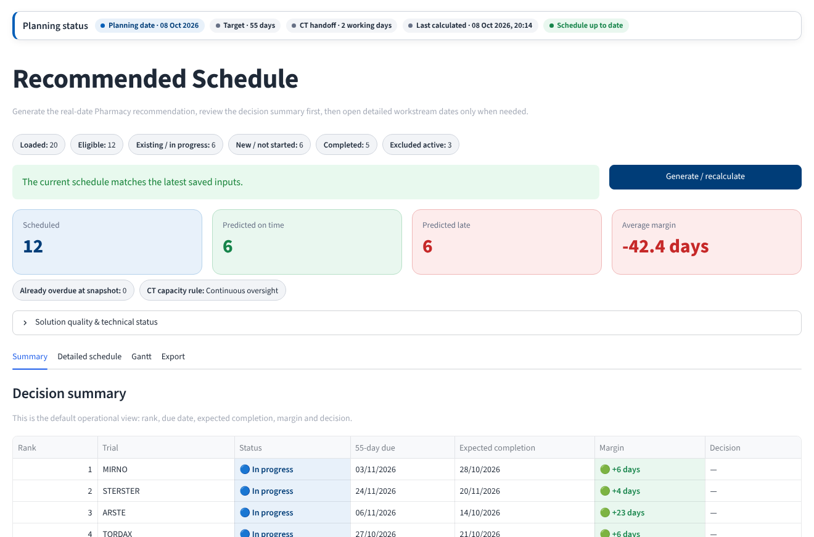
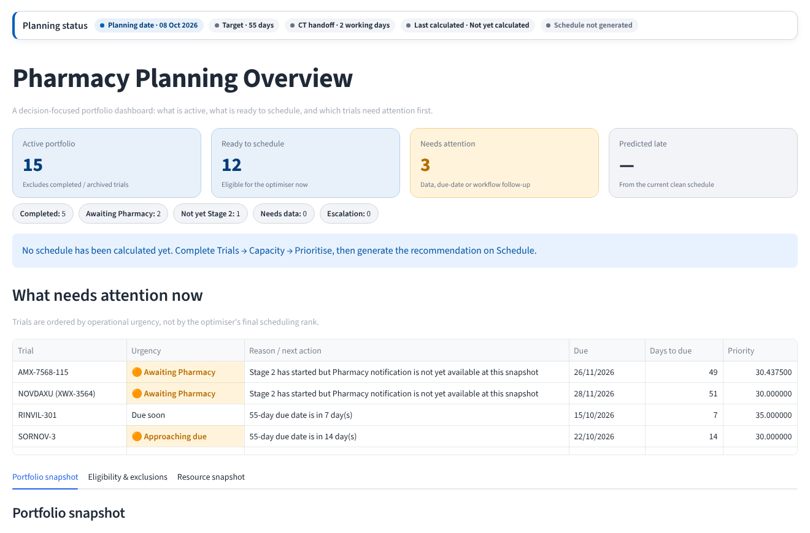
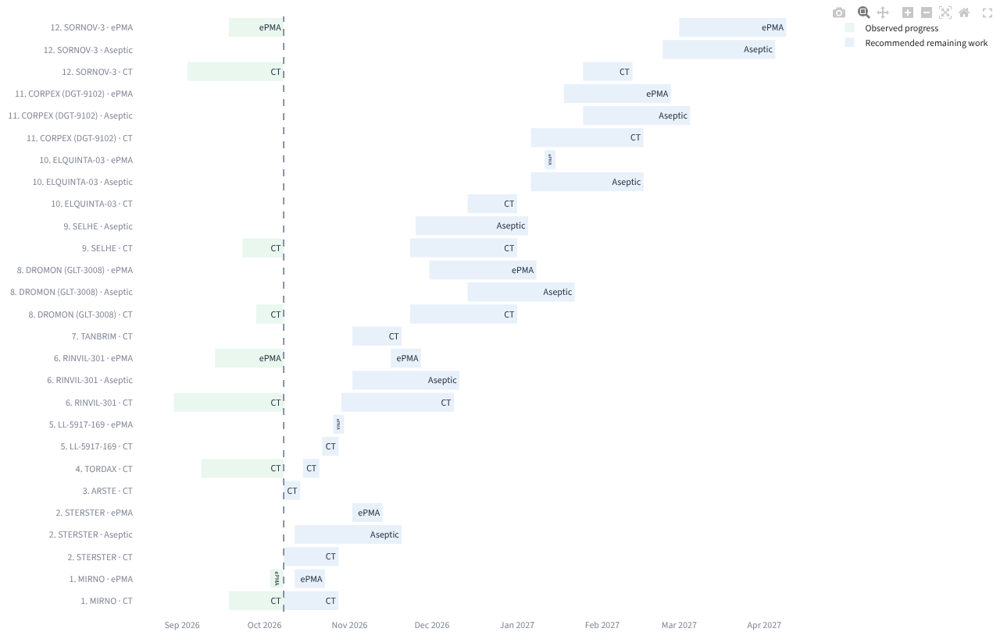
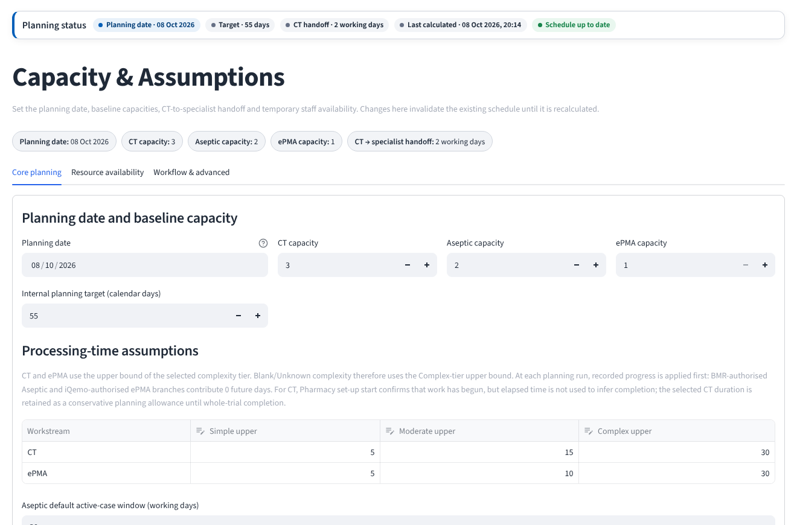

# Clinical Trial Pharmacy Set-up Scheduler

A Streamlit planning prototype designed to help a hospital pharmacy decide **which clinical trials to set up next, and when**, with the capacity available.

It combines a constraint-programming optimiser (Google OR-Tools CP-SAT) with a simple, step-by-step interface designed for non-technical pharmacy staff, with no coding needed.

**Live demo:** [nhs-trial-setup-scheduler.streamlit.app](https://nhs-trial-setup-scheduler.streamlit.app) — click **Run sample scheduling demo** on the first page to generate a schedule with synthetic trials. Then change **CT capacity** on the Schedule page and select **Recalculate and compare** to view modelled before-and-after outcomes.



---

## The problem

Before a clinical trial can open, the hospital pharmacy has to set it up: the clinical trials team prepares the trial, and some trials also need aseptic (sterile preparation) work and an electronic prescribing (ePMA) build. Each workstream has limited staff, the trials compete for the same people, and each trial has a target date for completion.

The question is not just "how long does each trial take?" but **"given limited capacity, what order and timing gets the most trials done on time, and which ones should we escalate?"**

## What the tool does

| Page | Purpose |
|---|---|
| **Overview** | Active portfolio, trials ready to schedule, what needs attention now (due soon, awaiting notification, missing data) |
| **Trials** | Upload any tracker workbook (Excel/CSV). Sheet, header row and column names are detected automatically and confirmed by the user. Data-quality checks flag gaps |
| **Capacity** | Planning date, staff capacity per workstream, processing-time assumptions by complexity, temporary capacity reductions (e.g. leave, training) |
| **Prioritise** | Review priority scores and, if needed, manually move a trial up or down the queue |
| **Schedule** | Run the optimiser and view recommended start/finish dates, predicted on-time / late status, a Gantt chart and Excel export. Try changing CT capacity to compare modelled outcomes |
| **Review** | Record final decisions and download a backup of the workspace |





## How the optimisation works

Each trial is broken into up to three workstreams (clinical trials team, aseptic, ePMA), each with its own capacity limit. The CP-SAT model schedules them on a working-day calendar and solves in two stages:

1. **Maximise the number of trials finishing on time.**
2. Keeping that number fixed, **minimise priority-weighted lateness**, where a trial's weight rises with its organisational priority and with how much of its target window has already been used.

Rules reflect how the work actually happens: specialist work starts a set number of working days after the clinical trials work begins, completed milestones remove that workload from future demand, and unknown complexity is treated conservatively (upper-bound duration) rather than guessed.

In my MSc dissertation’s **controlled 18-trial experiment**, the second optimisation stage reduced total **modelled lateness from 4,326 to 3,892 days (10.0%)**, while keeping the same number of on-time trials. In scenario tests, **shorter assumed processing durations** increased modelled on-time trials from **3 to 7 of 18**, while **additional CT capacity alone** raised them to **5**. These are modelled results, **not measured improvements in hospital operations**.

The 18-trial experiment used a common planning start to compare scheduling decisions under controlled conditions; it did not replay historical hospital operations as they occurred.



## Data and privacy

- **This repository contains no real hospital data.** The demo uses a synthetic portfolio of 20 fictitious trials (`sample_data.py`), generated relative to today's date so it always looks current.
- Default capacities and processing times are illustrative and can be changed on the Capacity page.
- In the public demo, nothing is written to the server. Set `PUBLIC_DEMO=0` to enable local autosave and named checkpoints when running on your own machine.
- `.gitignore` excludes Excel/CSV files and saved workspaces so real tracker data is never committed by accident.

## Run it locally

```bash

git clone https://github.com/inseo25611/nhs-trial-setup-scheduler.git
cd nhs-trial-setup-scheduler
pip install -r requirements.txt
streamlit run app.py
```

Then open the Overview page and click **Run sample scheduling demo**. The demo loads synthetic trials and generates a sample schedule. On the Schedule page, change **CT capacity** and click **Recalculate and compare** to explore the outcome. Alternatively, upload `sample_data/sample_trials.xlsx` on the Trials page to explore the manual upload and column-mapping workflow.

Requires Python 3.11+.

## Project structure

```
app.py                 # Entry point and page navigation
nhs_core.py            # Data loading, column mapping, operational rules, state
nhs_solver.py          # Prepares solver input and post-processes results
scheduler_engine.py    # CP-SAT optimisation model
ui_components.py       # Shared layout and styling
sample_data.py         # Synthetic demo portfolio
pages/                 # One file per page in the app
sample_data/           # Example workbook for testing the upload flow
```

## Tech stack

Python · Streamlit · Google OR-Tools (CP-SAT) · pandas · Plotly · openpyxl

## About

Built by **Inseo Lee** as part of an MSc Business Analytics (Operational Research and Risk Analysis) dissertation at the University of Manchester, in partnership with an NHS hospital trust. I designed the optimisation model, operational rules and interface, demonstrated the prototype to NHS pharmacy staff, and handed over a PowerPoint user guide. The prototype was not deployed as a live hospital system.


## Automated QA Testing

I extended this NHS scheduling application with automated tests using **Pytest and Playwright** to practise software quality assurance on a real Python project.

### What I tested

**Pytest – Data validation (3 tests)**
- Check the integrity of synthetic trial records.
- Verify the presence of incomplete data.
- Check specialist workstream requirements in the sample dataset.

**Playwright – Browser automation (2 tests)**
- Open the Streamlit application and load synthetic trial data.
- Change CT capacity, save the settings and generate a schedule.
- Verify the calculation status and confirm that capacity settings persist after navigating between pages.

**Local test results:** 5 tests passed (Python 3.14, October 2026).

### How to run the tests

Install the dependencies:

```bash
pip install -r requirements.txt
pip install pytest pytest-playwright
python -m playwright install chromium
```

Run the data tests:

```bash
python -m pytest -q tests/test_sample_data.py
```

Start the Streamlit application in one terminal:

```bash
python -m streamlit run app.py --server.port 8501
```

Then run the browser tests in another terminal:

```bash
python -m pytest -q tests/test_browser.py
```

These are smoke and data-validation tests, not a complete verification of the optimisation algorithm. The project uses synthetic demonstration data for public testing.

